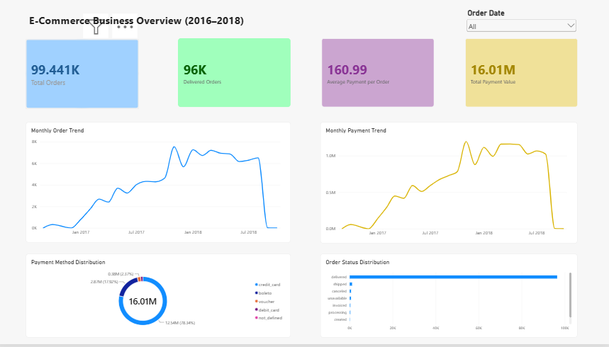
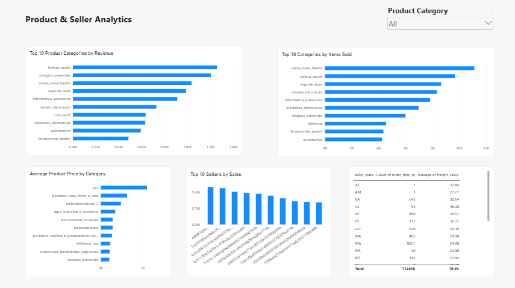
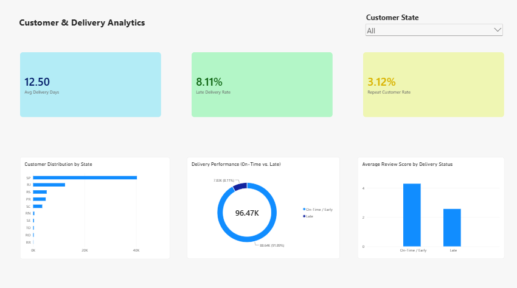

# E-Commerce Business Analytics Dashboard (2016–2018)

An end-to-end Data Analytics portfolio project analyzing **99,441 historical marketplace orders** from the [Brazilian E-Commerce Public Dataset by Olist](https://www.kaggle.com/datasets/olistbr/brazilian-ecommerce). The workflow spans exploratory analysis in **Python**, relational querying in **PostgreSQL**, and an interactive 3-page executive dashboard in **Power BI Desktop**.

---

## Dashboard Preview
### 1. E-Commerce Business Overview


### 2. Product & Seller Analytics


### 3. Customer & Delivery Analytics

---

## Repository Structure
```text
Ecommerce-Business-Analytics/
├── dashboard/
│   ├── ecommerce_business_analytics.pbix
│   └── ecommerce_business_analytics.pdf
├── data/
│   ├── raw/          # Kaggle Olist CSV files (excluded via .gitignore)
│   └── processed/
├── notebooks/
│   └── ecommerce_analysis.ipynb
├── reports/
│   ├── page1_business_overview.png
│   ├── page2_product_seller_analytics.png
│   └── page3_customer_delivery_analytics.png
├── sql/
│   └── analysis.sql
└── README.md